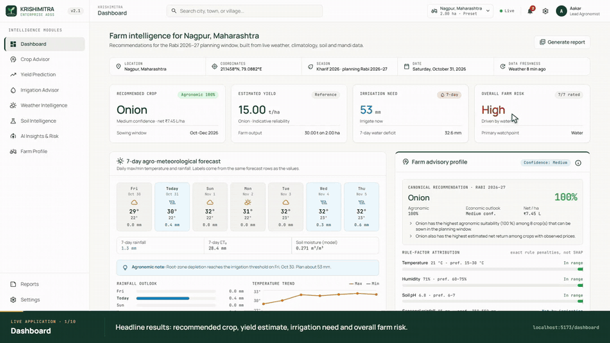
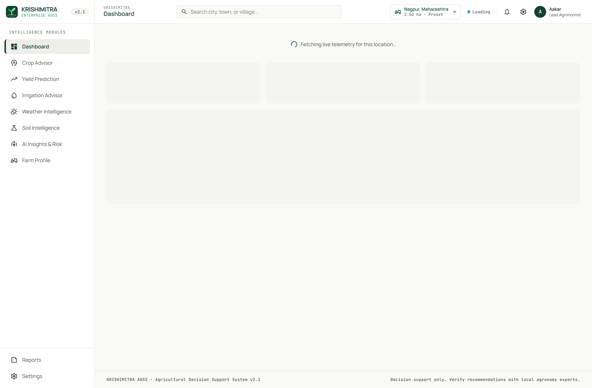
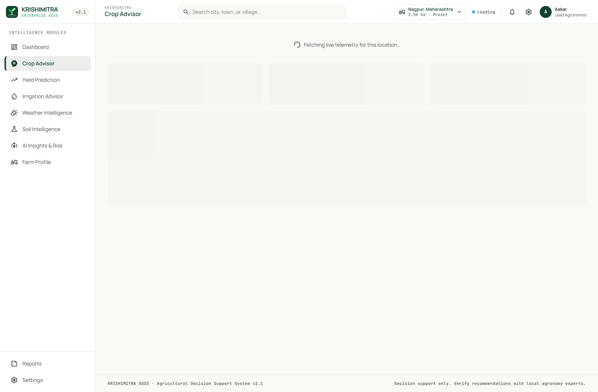
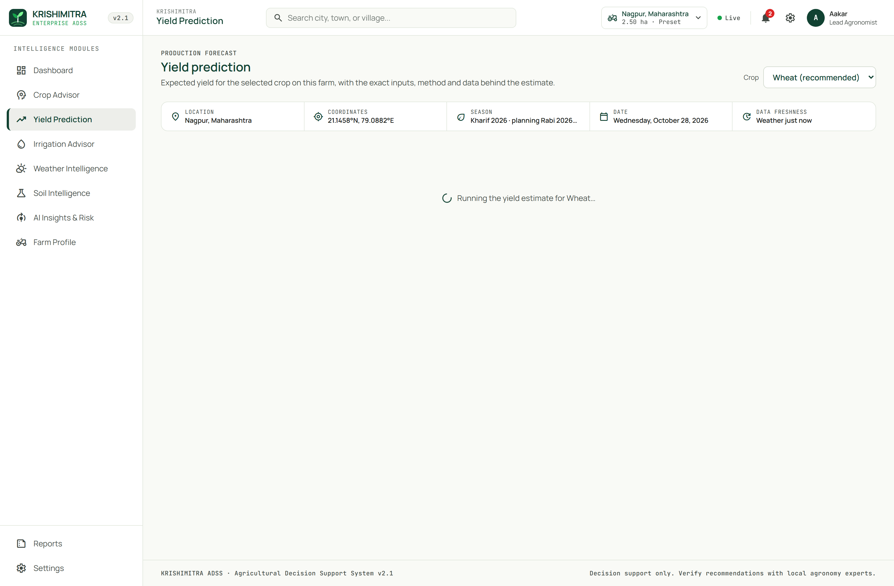
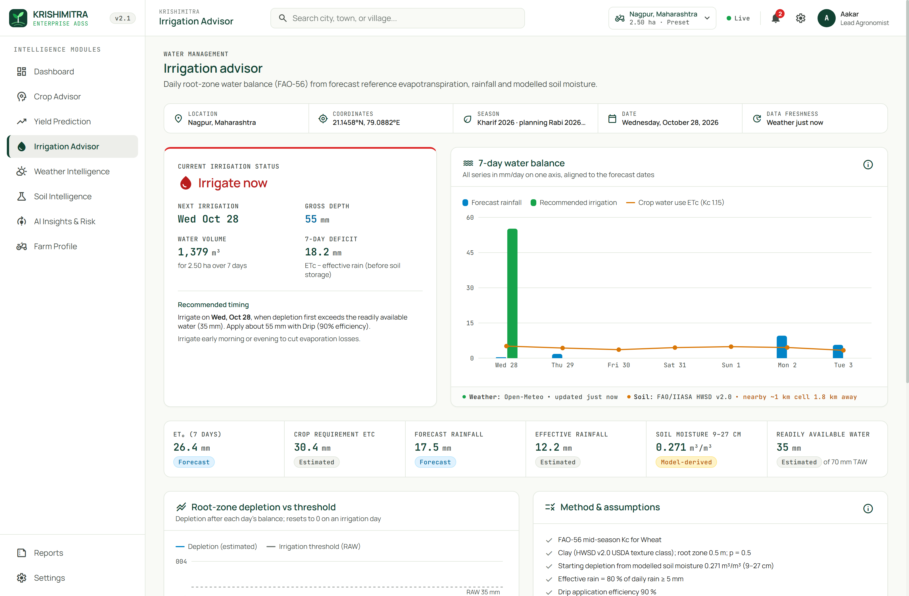
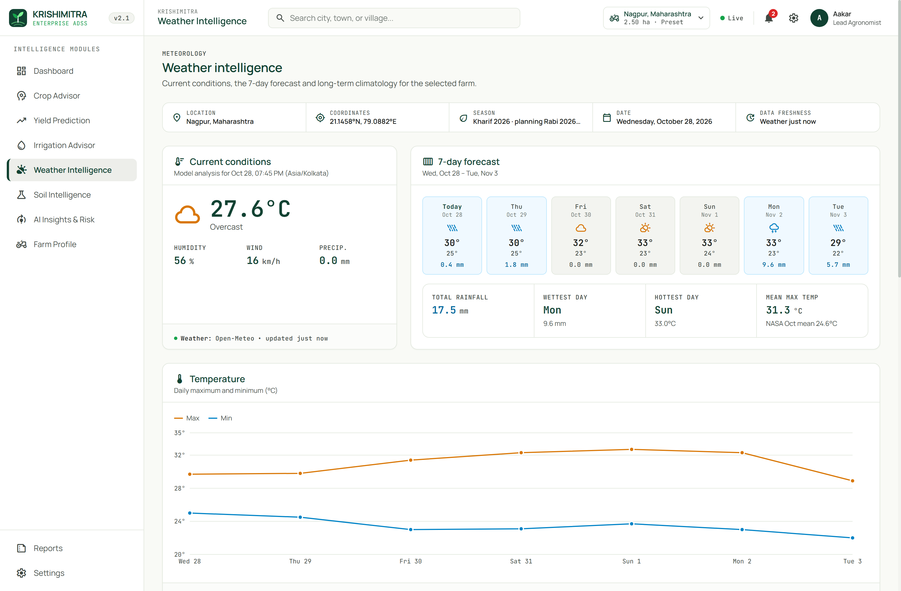
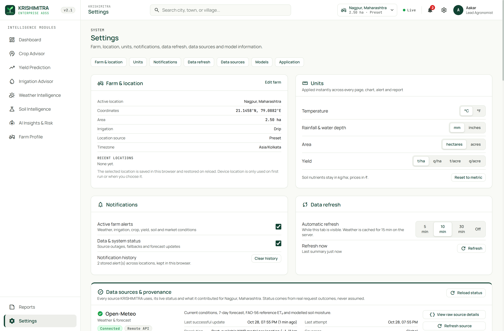
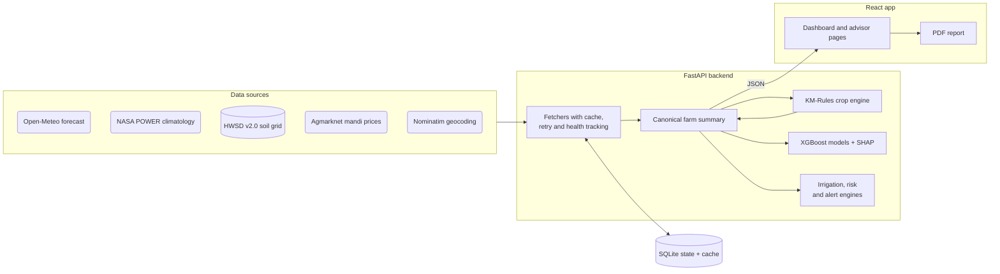
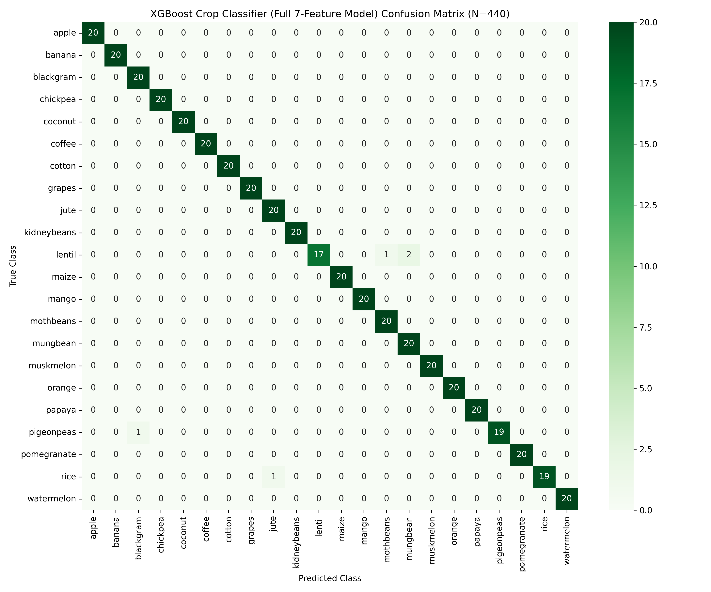
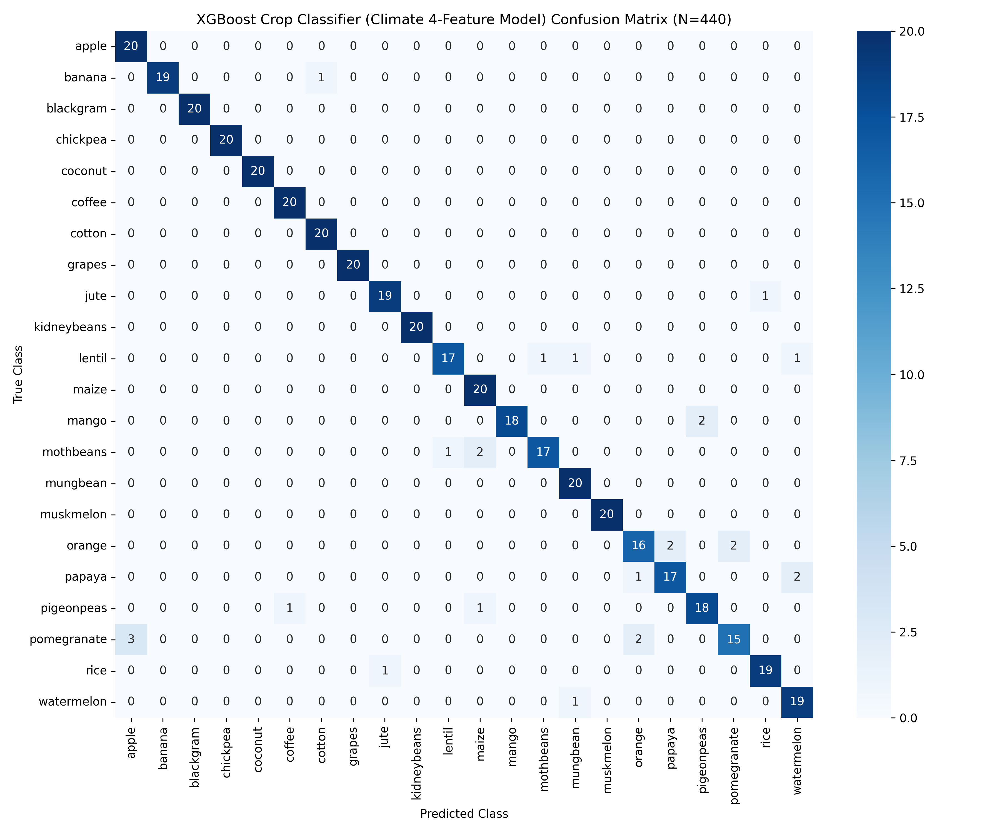

# KrishiMitra: An Explainable, Multi-Source Agricultural Decision Support System

<p align="center">
  
</p>

<p align="center">
  
  
  
  
  
  <a href="LICENSE"></a>
</p>

KrishiMitra turns scattered farm data into advice a farmer can check. It combines live weather, climatology, soil and market data for any location in India into one farm summary, then recommends what to sow, how much it may yield, when to irrigate and what risks to watch. Every recommendation shows the factors behind it and where each value came from.

## Demo

<p align="center">
  <a href="https://drive.google.com/file/d/1A8Z8P53Pe-GyHYCh7ZUpmb4MXLLrvqrE/view?usp=sharing">
    
  </a>
</p>

<p align="center">
  <a href="https://drive.google.com/file/d/1A8Z8P53Pe-GyHYCh7ZUpmb4MXLLrvqrE/view?usp=sharing"><b>▶ Watch the full 5-minute demo</b></a>
  &nbsp;·&nbsp;
  <a href="media/KrishiMitra_Video_Final.mov">Download the video (.mov, 67 MB)</a>
</p>

The video explains the problem and the architecture, then walks through every page of the running app for a demo farm in Nagpur.

## Contents

- [Why KrishiMitra](#why-krishimitra)
- [Features](#features)
- [Screenshots](#screenshots)
- [How it works](#how-it-works)
- [Data sources](#data-sources)
- [Model evaluation](#model-evaluation)
- [Getting started](#getting-started)
- [API](#api)
- [Project structure](#project-structure)
- [Documentation](#documentation)
- [Limitations](#limitations)
- [Authors](#authors)
- [License](#license)

## Why KrishiMitra

Weather forecasts, soil reports, crop calendars and mandi prices usually live in separate tools. Many machine-learning crop recommenders also report near-perfect benchmark accuracy without saying why they picked a crop or what happens when farm data is missing.

KrishiMitra takes a different approach:

- **One summary for every page.** A single backend summary feeds the dashboard, advisors and reports, so no two pages disagree.
- **Rules first, ML second.** A transparent rules engine decides the crop ranking. An XGBoost classifier gives an independent opinion beside it and never overrides it.
- **Honest about data.** Every value is labelled measured, modelled, fallback or unavailable. When a source fails, the app says so instead of inventing a number.

## Features

| Area | What it does |
|---|---|
| **Crop recommendation** | The rules engine ([`src/advisory/crop_rules.py`](src/advisory/crop_rules.py)) scores 12 crops against their preferred N, P, K, pH, seasonal rainfall, temperature and humidity, plus the Indian sowing calendar. Each factor outside its range lowers the score, and every factor shows its value and data source. |
| **Eligibility and ranking** | A crop is eligible when its sowing window is open or opens within 60 days, its suitability is at least 40 % and at least 2 factors could be checked. Crops are ranked by eligibility, then suitability, then net return per hectare from observed mandi prices. The most profitable eligible crop is shown separately as the economic trade-off. |
| **ML second opinion** | An XGBoost classifier (`crop_xgb`, 22 crops) shows its top 5 crops with probabilities and whether it agrees with the rules. With a soil test it uses 7 inputs (98.9 % hold-out accuracy); without one it uses temperature, humidity, pH and rainfall (94.1 %). |
| **Yield prediction** | An XGBoost regressor (`yield_xgb`) covers rice and wheat, shown with its hold-out error and a reliability label. Other crops use a labelled reference yield scaled by suitability. SHAP values explain the model's predictions. |
| **Irrigation** | A 7-day root-zone water balance based on FAO-56. It gives the next irrigation date, gross depth and water volume, and lists its assumptions. |
| **Risk** | A 7-category risk matrix (climate, water, suitability, yield, pest, soil, market), each with the evidence behind its rating. |
| **Weather and soil** | Open-Meteo forecast with ET₀ and soil moisture, compared against 5-year NASA POWER climatology. Topsoil properties come from the ~1 km HWSD v2.0 grid. |
| **Alerts** | Notifications from live data: heavy rain (IMD thresholds), heat and frost, irrigation need, crop and soil constraints, price changes and source outages. They are kept per farm location. |
| **Reports** | PDF reports generated in the browser from the live summary, with a data-source status table on every report. |
| **Transparency** | Settings shows each source's status, last successful fetch, fallback use and raw payload. Every model-driven panel has an "i" button that opens its model card: method, dataset, split, metrics and limitations. |

## Screenshots

| Dashboard | Crop advisor |
|---|---|
|  |  |
| **Yield prediction** | **Irrigation advisor** |
|  |  |
| **Weather intelligence** | **Data sources and provenance** |
|  |  |

More screenshots are in [`docs/research_paper/figures/screenshots/`](docs/research_paper/figures/screenshots/).

## How it works



1. The browser sends the farm location, area, irrigation type and optional soil test.
2. The backend fetches all sources at the same time. Each response is cached, and failures fall back to the last good value or are marked unavailable.
3. The rules engine ranks the crops. The ML classifier, yield model, irrigation balance and risk engines each add their part to one summary.
4. Every page reads that summary, so the dashboard, advisors and PDF report always show the same numbers.

**Tech stack:** Python 3.14, FastAPI, XGBoost, scikit-learn, SHAP, pandas, SQLite · React 19, TypeScript, Vite, Tailwind CSS 4, Zustand, Recharts, Leaflet, jsPDF.

## Data sources

| Source | Type | Used for | Access |
|---|---|---|---|
| **Open-Meteo** | Weather | Current conditions, 7-day forecast, FAO-56 ET₀, modelled soil moisture | Live API |
| **NASA POWER** | Climate | 5-year monthly climatology for the crop's growing season | Live API |
| **FAO/IIASA HWSD v2.0** | Soil | Topsoil pH, texture, sand/silt/clay, organic carbon, total N, CEC (~1 km, 0–20 cm) | Local raster + SQLite |
| **Agmarknet (data.gov.in)** | Market | Daily mandi modal prices from the district or the nearest market | Live API |
| **OpenStreetMap Nominatim** | Geocoding | Place search and district/state lookup for market matching | Live API |
| **FAOSTAT** | Yield history | National yields; yield-model training (20-row local sample) | Offline CSV |
| **[Crop recommendation dataset](https://www.kaggle.com/datasets/atharvaingle/crop-recommendation-dataset)** | Agronomic | `crop_xgb` training data (2,200 rows, 22 crops) | Offline CSV |

## Model evaluation

Metrics are computed by `python -m src.models.train`, saved in `models/*_meta.json` and shown in the app's model cards.

**Crop classifier (`crop_xgb`)**: stratified 80/20 split (1,760 train / 440 test rows, 20 per crop, `random_state=42`) plus stratified 5-fold cross-validation. Precision, recall and F1 are macro averages over the 22 crops; with balanced classes the weighted averages are the same.

| Variant | Inputs | Accuracy | Precision | Recall | F1 | 5-fold CV accuracy |
|---|---|---|---|---|---|---|
| Full (soil test) | N, P, K, temperature, humidity, pH, rainfall | 98.9 % | 98.9 % | 98.9 % | 98.8 % | 99.3 % ± 0.3 |
| Climate + pH | temperature, humidity, pH, rainfall | 94.1 % | 94.2 % | 94.1 % | 94.0 % | 95.8 % ± 0.5 |

Per-crop precision, recall, F1 and the full 22 × 22 confusion matrix are in `models/crop_meta.json` and the crop classifier's model card. Weakest crops: lentil (full, recall 85 %), pomegranate and orange (climate, F1 81–82 %). These are benchmark results on a public dataset, not field accuracy.

| Confusion matrix (full) | Confusion matrix (climate + pH) |
|---|---|
|  |  |

**Yield regressor (`yield_xgb`)**: random 80/20 split of the FAOSTAT sample (16 train / 4 test rows). MAE 0.031 t/ha, RMSE 0.047 t/ha, R² −5.33. Precision, recall and F1 do not apply to regression. Three of the four test rows are placeholder values, so these numbers say little about real accuracy, and the app marks the model's estimates as low reliability.

**Rules engine, irrigation, soil and risk logic**: no labelled ground truth exists, so accuracy, precision, recall and F1 cannot be computed. Their behaviour is covered by the unit tests in `tests/test_core.py`.

## Getting started

### Prerequisites

- Python 3.14
- Node.js 20.19 or newer (for Vite 8)
- About 2 GB of disk space if you build the local soil database

### 1. Install

```bash
git clone https://github.com/AakarGupta-coder/KrishiMitra-ADSS.git
```

```bash
cd KrishiMitra-ADSS
```

```bash
pip install -r requirements.txt
```

The versions in `requirements.txt` are pinned to the ones the bundled models were trained with. Other XGBoost or scikit-learn versions may fail to load the `.pkl` files.

### 2. Configure

Copy `.env.example` to `.env` and fill it in:

```env
# Agmarknet mandi prices (data.gov.in). Without a key the public sample key is used,
# which returns at most 10 records per call and is quickly rate-limited (HTTP 429).
# Register for a free personal key at https://data.gov.in and set it here.
DATA_GOV_IN_API_KEY=""

# Where runtime state (source health, market observations, geocode cache) is stored.
KRISHIMITRA_STATE_DB="data/krishimitra_state.sqlite"

# Frontend: backend URL used by the React app (Vite reads VITE_* variables).
VITE_API_BASE="http://localhost:8000"

# Application settings
ENVIRONMENT="development"
LOG_LEVEL="INFO"
```

### 3. Build the soil database (optional, one time)

Download `HWSD2_RASTER.zip` and `HWSD2_DB.zip` from the [FAO HWSD page](https://www.fao.org/land-water/resources/tools/databases/hwsd/en) and extract them into `data/hwsd/raw/`. Then run:

```bash
powershell -File scripts/hwsd/export_mdb.ps1
```

```bash
python scripts/hwsd/build_hwsd.py
```

Without it, soil data shows as unavailable and the rest of the app still works.

### 4. Run

Start the backend from the repository root:

```bash
python -m uvicorn api.main:app --reload
```

Start the frontend in a second terminal:

```bash
cd frontend && npm install && npm run dev
```

Open http://localhost:5173 and choose a location.

### Retrain the models (optional)

Pre-trained models are included in `models/`. To retrain them:

```bash
python -m src.models.train
```

### Run the tests

```bash
python -m pytest tests
```

## API

The backend serves JSON on port 8000. Interactive docs are at http://localhost:8000/docs.

| Method | Endpoint | Returns |
|---|---|---|
| GET | `/api/farm/summary` | The canonical farm summary every page uses |
| GET | `/api/advisory/crop` | Crop ranking, optionally with what-if rainfall and temperature |
| GET | `/api/advisory/yield` | Yield estimate for one crop, with inputs and SHAP values |
| GET | `/api/weather/forecast` | Forecast and climatology for a location |
| GET | `/api/soil/properties` | HWSD v2.0 topsoil properties for a location |
| GET | `/api/models`, `/api/models/{model_id}` | Model cards with method, data and metrics |
| GET | `/api/sources` | Status of every data source |
| POST | `/api/sources/{source_id}/refresh` | Re-fetch one source |
| GET | `/api/sources/{source_id}/raw` | Last raw payload from one source |
| GET | `/api/health` | Backend health check |

## Project structure

```text
KrishiMitra-ADSS/
├── api/                     # FastAPI application and routes
├── src/
│   ├── data/                # Open-Meteo, NASA POWER, Agmarknet and Nominatim clients, HWSD lookup, SQLite store
│   ├── advisory/            # Crop rules, irrigation, risk and soil engines
│   ├── models/              # Training, inference and the yield service (with SHAP)
│   ├── features/            # Feature engineering for training
│   └── services/            # Builds the canonical farm summary and model cards
├── frontend/                # React + TypeScript app (pages, components, hooks, stores)
├── models/                  # Trained models and their metrics
├── data/                    # Training CSVs; local soil database and app state (not in git)
├── scripts/                 # Soil database build, report and video tooling
├── tests/                   # pytest suite
├── docs/                    # Technical documentation, design system, research evidence
├── media/                   # Demo video
└── assets/images/           # Logo, demo preview and architecture image
```

## Documentation

| Document | What it covers |
|---|---|
| [Technical handover](docs/KrishiMitra_Handover_Master.md) | Architecture, data pipeline, models, API and frontend in depth |
| [Research and evidence](docs/research_paper/KrishiMitra_Research_Master.md) | Data provenance, experiment log, the evidence behind each claim and the literature review |
| [Experiments and results](docs/research_paper/results/) | Model comparison and confusion matrices, reproduced by [`run_experiments.py`](docs/research_paper/experiments/run_experiments.py) |
| [Demo video guide](media/KrishiMitra_Video_Final_Master.md) | Full narration script, scene timeline and the features each scene shows |
| [Design system](docs/design/KrishiMitra_Design_System.md) | Colours, type and components the frontend follows |

## Limitations

- **Decision support, not instruction.** Recommendations come from a transparent rules engine and public data. Check them against local knowledge before acting.
- **ML opinion.** The crop classifier is trained on a public benchmark that is not specific to any region, and its classes separate so cleanly that probabilities are often near 100 %. Only 2 of its 22 crops (mung bean, black gram) are among the 12 the rules engine evaluates, so the two often cannot be compared directly. It is shown for comparison only.
- **Yield data.** `data/faostat_sample.csv` has 20 rows, 15 of which repeat one placeholder value, and the yield model's hold-out R² is negative. Its estimates are marked low reliability. A full FAOSTAT export and re-running `python -m src.models.train` are needed before the yield model carries real weight.
- **Soil.** HWSD v2.0 gives ~1 km regional estimates, not field measurements. A soil test entered in Farm Profile replaces them.
- **Irrigation.** The water balance uses textbook parameters that have not been calibrated with field sensors.
- **Data gaps.** When a source is unavailable, the app shows the gap instead of inventing a value.
- **Market data.** The public data.gov.in sample key is heavily rate-limited. Without a personal key, prices may fall back to the last observed Agmarknet price.

## Authors

- **Aakar Gupta**
- **Prathamesh Avinash Burange**

## License

### Project code

The code in this repository (`api/`, `src/`, `frontend/`, `scripts/`, `tests/`) and the trained models in `models/` are released under the [MIT License](LICENSE). Copyright (c) 2026 Aakar Gupta and Prathamesh Avinash Burange.

In short, you may use, copy, modify, merge, publish, distribute, sublicense and sell copies of the code, for any purpose, as long as you keep the copyright notice and the licence text. The software comes with no warranty: the authors are not liable for any loss, including crop or financial loss, from using it.

### Documents and media

The documents in `docs/` and the demo video in `media/` are shared for reading and reference. If you reuse their content, credit the authors. Logos of other organisations in `assets/images/` belong to their owners and are not covered by the MIT License.

### Data sources

Each data source keeps its own licence. Anyone who redistributes or builds on this project must follow them.

| Source | Licence and terms | What it requires |
|---|---|---|
| [Open-Meteo](https://open-meteo.com/en/licence) | CC BY 4.0 for API data; the free API is for non-commercial use | Credit "Weather data by Open-Meteo.com" with a link |
| [NASA POWER](https://power.larc.nasa.gov/) | Free public data from NASA Langley Research Center | Acknowledge the NASA POWER Project as the source |
| [FAO/IIASA HWSD v2.0](https://www.fao.org/soils-portal/data-hub/soil-maps-and-databases/harmonized-world-soil-database-v20/en/) | CC BY-NC-SA 3.0 IGO | Credit FAO and IIASA; no commercial use; share adaptations under the same licence. The database is not in this repository: download it yourself (see Getting started) |
| [Agmarknet via data.gov.in](https://data.gov.in/) | Government Open Data License – India | Credit the source; use your own data.gov.in API key |
| [OpenStreetMap Nominatim](https://operations.osmfoundation.org/policies/nominatim/) | Data © OpenStreetMap contributors, ODbL | Credit OpenStreetMap; at most 1 request per second; send a valid User-Agent |
| [FAOSTAT](https://www.fao.org/faostat/) | CC BY 4.0 | Credit FAO. Most rows in `data/faostat_sample.csv` are placeholders, not FAOSTAT values (see Limitations) |
| [Kaggle crop recommendation dataset](https://www.kaggle.com/datasets/atharvaingle/crop-recommendation-dataset) | Set by its author on the Kaggle page | Check the licence there before redistributing `data/crop_recommendation.csv` |

Because HWSD v2.0 is non-commercial, any commercial use of the soil features needs a different soil source, even though the code itself is MIT.

### Third-party libraries

Python and JavaScript dependencies (FastAPI, XGBoost, SHAP, scikit-learn, React, Recharts, Leaflet, jsPDF and others) are installed from `requirements.txt` and `frontend/package.json`. They keep their own open-source licences and are not bundled in this repository.

### Disclaimer

KrishiMitra is a decision-support prototype. Its advice is not a substitute for a local agronomist, a soil test or official advisories. Check recommendations before acting on them.
